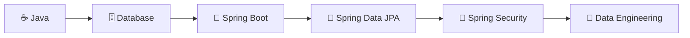

# 🧠 Software Engineer Vault

> [!quote] 💬 Learn it → explain it → build it → tick it.
> A checkbox means *"I can explain this out loud and write the code without copying"* — not *"I read it"*.

## 🗺️ Learning Path



## 📚 Tracks

| | Track | What's inside |
|---|---|---|
| ☕ | [[01 - Java/00 - Overview\|Java]] | Core concepts and a 690-question interview reference. |
| 🗄️ | [[02 - Database/00 - Overview\|Database]] | SQL and PostgreSQL in three tiers — must know, professional, legend. |
| 🌱 | [[03 - Spring Boot/00 - Overview\|Spring Boot]] | Spring Framework Core + Spring Boot internals — IoC/DI, bean lifecycle, AOP, Spring MVC, auto-configuration, configuration, Actuator, testing and a project ladder. |
| 💾 | [[04 - Spring Data JPA/00 - Overview\|Spring Data JPA]] | From relational theory and SQL up through JDBC, Hibernate, Spring Data repositories, performance tuning and transactions. |
| 🔐 | [[05 - Spring Security/00 - Overview\|Spring Security]] | Security theory, crypto and web attacks first — then the filter chain, authentication, authorization, JWT, OAuth2, testing and production hardening. |
| 🚀 | [[06 - Java Data Engineering/00 - Overview\|Java Data Engineering]] | Four-phase path from backend engineer to data engineer, plus portfolio projects and a local-reality playbook. |

## 🔥 In Progress

```base
filters:
  and:
    - 'note.type == "topic"'
    - 'note.status == "learning"'
views:
  - type: table
    name: 🔥 Learning now
    order:
      - file.name
      - note.series
      - note.stage
      - note.items
```

## ✅ Done

```base
filters:
  and:
    - 'note.type == "topic"'
    - 'note.status == "done"'
views:
  - type: table
    name: ✅ Finished
    order:
      - file.name
      - note.series
      - note.stage
```

## 🧭 How to use this vault

1. 📂 Pick a track above → open a **stage** → open a **topic** note.
2. 📝 Fill **My Notes**, **Code**, **Gotchas** in your own words — this is where learning happens.
3. ☑️ Tick checklist items only when you can explain them. Set `status: learning` / `status: done` in the note properties.
4. 🔗 Link related topics under **🔗 Related** — the graph view grows with you.
5. 🆕 New concept? Create a note from **99 - Templates/📝 Topic Note**.
